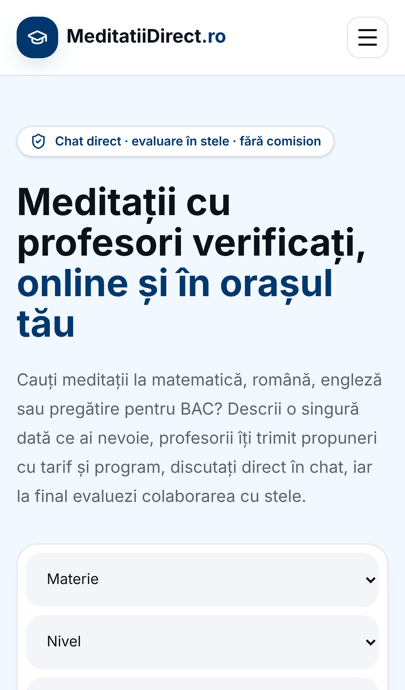

# MeditatiiDirect — aplicația iPhone

Aplicația iOS pentru [https://meditatiidirect.ro](https://meditatiidirect.ro): site-ul complet (cereri, meditații, cont, Profesor AI live cu microfon) într-o aplicație nativă (Capacitor 7, Swift Package Manager, fără CocoaPods).



**Live:** https://meditatiidirect.ro

## Rulează pe iPhone (Mac cu Xcode)

```bash
git clone https://github.com/alexalghisi/meditatiidirect-ios.git
cd meditatiidirect-ios
npm install
npx cap open ios
```

În Xcode: target **App** → *Signing & Capabilities* → alege echipa ta (Apple ID) → conectează iPhone-ul → ▶ Run.

## Ce include
- Bundle ID `ro.meditatiidirect.app`, nume „MeditatiiDirect”, iconiță proprie
- Permisiuni în română pentru microfon (Profesor AI), cameră și poze
- Pagină „fără internet” locală
- Orice modificare pe site apare imediat în aplicație, fără update în App Store
